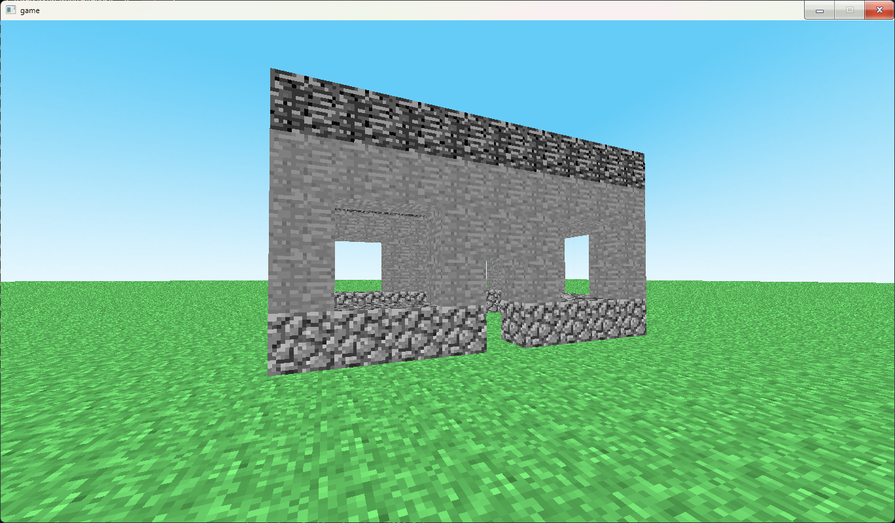

Проект для практики opengl, а так же создание собственного клона Minecraft.
В будущем проект должен перерости в самостоятельную игру.

Используется Opengl 3.3 (С целью совместимости со старыми устройствами), [glfw](https://github.com/glfw/glfw), [glm](https://github.com/g-truc/glm), [stb](https://github.com/nothings/stb), [assimp](https://github.com/assimp/assimp) и [Nlohmann json](https://github.com/nlohmann/json)

Есть несколько вещей которые я планирую переделать:

1. Mesh builder не такой эффективный как хотелось бы.
2. Коллизии, игрок иногда сталкивается с фантомными стенами при ходьбе по поверхности
3. Исправить non_vs_build_release.cmd

Сборка:
Через Visual Studio
или
В Developer Powershell запустить non_vs_build.cmd

Зависимости должны установится автоматически
